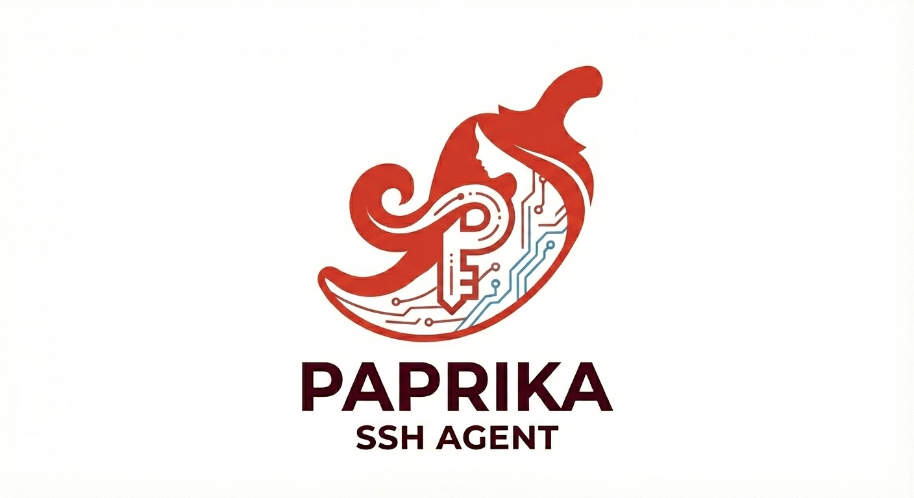

<p align="center">
  
</p>

<p align="center">
  <a href="https://github.com/klobucar/paprika/actions/workflows/ci.yml"></a>
  
  
  <a href="LICENSE"></a>
</p>

# Paprika

Paprika is a command-line SSH agent for macOS. It keeps your private keys in the Secure Enclave and asks for Touch ID each time it signs. You can use the same key to log in to a server, push to GitHub, or sign a Git commit.

Paprika works with OpenSSH through `SSH_AUTH_SOCK`. That covers `ssh`, `scp`, and tools like Git and rsync when they use OpenSSH. If your Git client has its own SSH implementation, check whether it supports the SSH agent protocol.

Paprika is for sitting at a Mac with Touch ID. Scheduled jobs, CI runners, and headless machines need another way to sign unattended. If you'd prefer a menu bar app for the same day-to-day SSH workflow, try [Secretive](https://github.com/maxgoedjen/secretive).

## Build and install

Paprika is a source-only preview. You'll need macOS 14 or later, Swift 5.10 or later, a Mac with Secure Enclave and Touch ID, and a paid Apple Developer membership for signing. A notarized download and Homebrew install are planned.

1. Build the release binary.

   ```sh
   git clone https://github.com/klobucar/paprika.git
   cd paprika
   swift build -c release
   ```

2. Create a throwaway macOS app in Xcode with the bundle identifier `com.paprika.agent`. Select your development team, enable Keychain Sharing, and build the app (⌘B). Look for the generated development provisioning profile in `~/Library/Developer/Xcode/UserData/Provisioning Profiles/`.

3. Put `.build/release/paprika` in `Paprika.app/Contents/MacOS/`. In `Contents/Info.plist`, set `CFBundleExecutable` to `paprika`, `CFBundleIdentifier` to `com.paprika.agent`, and `CFBundlePackageType` to `APPL`. Copy the provisioning profile to `Contents/embedded.provisionprofile`.

4. Create a `local-entitlements.plist` that matches the profile. Use your team ID for `com.apple.developer.team-identifier` and `TEAMID.com.paprika.agent` for both `com.apple.application-identifier` and the entry in the `keychain-access-groups` array. Set `com.apple.security.get-task-allow` to true for the development build. Substitute your signing identity below.

   ```sh
   codesign --force --sign "Apple Development: YOUR NAME" \
     --entitlements local-entitlements.plist --options runtime --timestamp Paprika.app
   ./Paprika.app/Contents/MacOS/paprika --help
   ```

macOS uses the profile to authorize the keychain access group. The development build runs on Macs covered by the profile.

Put the signed app somewhere you plan to keep it. From the directory containing it, run:

```sh
./Paprika.app/Contents/MacOS/paprika install
launchctl bootstrap "gui/$UID" "$HOME/Library/LaunchAgents/com.paprika.agent.plist"
```

The agent starts at login after that. Add these lines to your shell startup file and replace `/path/to` with the directory containing `Paprika.app`.

```sh
export PATH="/path/to/Paprika.app/Contents/MacOS:$PATH"
export SSH_AUTH_SOCK="$HOME/.paprika/agent.sock"
```

## Use Paprika

Generate a key and copy its public half to your clipboard.

```sh
paprika generate github
paprika show github | pbcopy
```

Paste the public key into your Git host's SSH key settings or add it to a server's `~/.ssh/authorized_keys`. Then use `ssh` or `git push` as usual. Touch ID comes up when the client requests a signature. To print the key's SHA-256 fingerprint, run `paprika show github --fingerprint`.

`paprika delete github` permanently deletes the key. Make sure you still have another way into any account or server that uses it. To stop the background agent and remove its launchd entry while keeping your keys, use `paprika uninstall`.

### Sign Git commits

Run this in your repo to set up SSH signing and add the public key to your local verification list.

```sh
paprika git-setup github --add-to-allowed
git commit -S
git log --show-signature -1
```

Add `--global` to apply the Git settings across repos. You can leave out the key name if you've generated only one key. If you want Git to sign every commit in the repo by default, set `git config commit.gpgsign true`.

### Use your key from a remote machine

Connect with `ssh -A minimac` from the Mac running Paprika. SSH and Git commands on the remote machine can use the forwarded agent, and the Touch ID prompt appears on your Mac.

Forward your agent only to hosts you trust. A privileged process on the remote host can send signing requests through the forwarded socket while the session is open. Those requests still prompt for Touch ID. If the remote machine is just a hop on the way to another host, use `ssh -J` to connect through it without forwarding the agent.

## Threat model

Paprika generates ECDSA P-256 keys inside the Secure Enclave. The private key is tied to that Mac and can't be exported or backed up. Each signing request gets a fresh authentication context. If your enrolled fingerprints change, you'll need to generate new keys and replace the public keys wherever you registered them.

The agent listens on a local Unix socket at `~/.paprika/agent.sock`. It checks ownership of the socket directory, sets directory permissions to `0700` and socket permissions to `0600`, and caps incoming messages at 256 KiB.

A process running as you can still ask the agent to sign. Decline Touch ID prompts you didn't expect. Paprika assumes macOS and the Secure Enclave are trusted. For vulnerability reports, see the [security policy](SECURITY.md).

## Status and logs

`paprika status` shows the signing identity, launchd entry, socket, and key count. Use `paprika status --keys` for key names and fingerprints or `paprika status --audit --tail 10` for recent signing activity. Audit entries can include usernames, hostnames, and signing times.

Daemon messages go to the macOS unified log.

```sh
log stream --predicate 'subsystem == "com.paprika.agent"'
log show --predicate 'subsystem == "com.paprika.agent"' --last 1h
```

## Credits

Claude helped with the design, implementation, tests, and documentation. The maintainer reviewed and tested the changes.

## License

[MIT](LICENSE)
